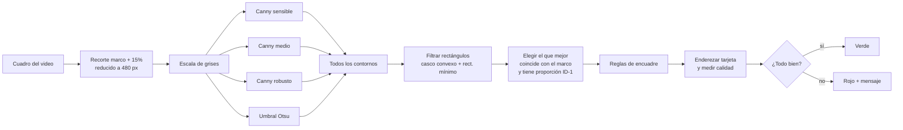

# Proceso de desarrollo · MF OCR (prueba de captura)

Este documento cuenta cómo se llegó al estado actual de la prueba: desde la elección de
librerías y los primeros problemas con la cámara, hasta el detector automático de la INE.
Está ordenado de lo más simple a lo más complejo, y en cada etapa se explica **qué se hizo,
por qué, y qué problema resolvió**.

---

## 1. Objetivo de la prueba

Validar, en el navegador del teléfono, que podemos:

1. Abrir la cámara trasera y capturar una **INE** (frente y reverso) y **documentos**
   (Comprobante / Factura).
2. Entregar una imagen **limpia** para el OCR: solo el documento, derecho y nítido.
3. En la INE, **detectar automáticamente** cuándo la tarjeta está bien colocada y tomar la foto sola.
4. Armar el **JSON** (payload) con la imagen, datos del dispositivo y telemetría, con la forma
   que espera el backend de OCR.

---

## 2. Librerías: qué se usa y por qué

La base del proyecto (React 18, Vite 8, TypeScript, Node 24, `react-webcam`, `jscanify` y
OpenCV.js) ya venía definida al iniciar. Durante el desarrollo se agregaron dos piezas pequeñas.

| Librería | Para qué | Por qué esta |
| --- | --- | --- |
| **React 18 + TypeScript** | Interfaz y estado del flujo | Estándar del equipo; TypeScript estricto evita errores en el payload y en la geometría |
| **Vite 8** | Servidor de desarrollo y build | Arranque instantáneo y recarga en caliente; permite importar archivos como URL (`?url`), clave para cargar OpenCV |
| **react-webcam** | Mostrar el video de la cámara y tomar la foto (`getScreenshot`) | Envuelve `getUserMedia` con un componente simple y da acceso al `<video>` real para analizarlo cuadro por cuadro |
| **OpenCV.js** (`@techstark/opencv-js`) | Visión por computadora: bordes, contornos, perspectiva | Es OpenCV compilado a WebAssembly: los mismos algoritmos que en escritorio, corriendo en el teléfono sin servidor |
| **jscanify** | Aplanar documentos "tipo Office Lens" | Ya resuelve "encuentra la hoja y enderézala" sobre OpenCV; ideal para hojas grandes y claras (comprobantes, facturas) |
| **@vitejs/plugin-basic-ssl** *(agregada)* | HTTPS en desarrollo | El teléfono **solo** da acceso a la cámara en HTTPS; sin esto no aparecía el permiso |
| **jpeg-js + pngjs** *(agregadas, solo desarrollo)* | Leer fotos en Node | Para calibrar el detector con fotos reales sin cámara ni navegador (sección 9) |

> **Nota:** jscanify sirve muy bien para documentos, pero para la INE terminó siendo
> insuficiente. Por eso la INE usa un detector propio escrito directamente con OpenCV
> (secciones 7 y 8).

---

## 3. Primeros pasos: que la cámara funcione

### 3.1 jscanify no cargaba (resolución de módulos)
- **Problema:** Vite fallaba con `'./client/client' is not exported…`. Un alias
  `jscanify → jscanify/client` se aplicaba dos veces.
- **Solución:** un pequeño plugin en `vite.config.ts` (`jscanifyBrowserResolve`) que apunta
  directo al archivo de navegador `node_modules/jscanify/src/jscanify.js`, y excluir jscanify
  del pre-empaquetado de Vite.

### 3.2 El permiso de cámara no aparecía en el teléfono
- **Problema:** abriendo `http://IP-de-la-PC:3015`, el teléfono no mostraba ningún popup.
  Los navegadores solo permiten cámara y GPS en **contexto seguro** (HTTPS o `localhost`).
- **Solución:** `@vitejs/plugin-basic-ssl` para servir en HTTPS con un certificado de desarrollo.
  La app además detecta si no está en contexto seguro y lo explica en pantalla.

### 3.3 La geolocalización bloqueaba todo en PC
- **Problema:** `GeolocationPositionError code 3 (Timeout)`. En PC no hay GPS y el flujo se
  quedaba atorado.
- **Solución:** primero un reintento con baja precisión; después, a petición, la geolocalización
  quedó **comentada** (lista para activarse en `hooks/useCameraPermission.ts`). El payload ya
  contempla `gpsData: null`.

---

## 4. Recortar la foto al marco guía

- **Problema:** la vista previa mostraba la foto completa y no solo lo que estaba dentro del marco.
- **Por qué no es trivial:** el video se muestra con `object-fit: cover`, es decir, se escala y
  se recorta para llenar la pantalla. El marco está en **coordenadas de pantalla**, pero la foto
  está en **píxeles del video** (por ejemplo 1920×1080), con partes que no se ven.
- **Solución (`vision/guideFrame/guideFrameGeometry.ts`):**
  1. Se calcula a qué tamaño se está pintando realmente el video y cuánto sobresale.
  2. Se traduce el rectángulo del marco (pantalla) a píxeles del video.
  3. Opcionalmente se agrega un **margen** alrededor del marco (se usa en la INE, ver 7.2).

  `cropToGuideFrame.ts` usa ese mapeo para recortar la foto en un canvas.

---

## 5. Modos de captura y payload

### 5.1 INE vs Documento
- Un **switch arriba a la izquierda** elige INE o Documento (sustituye a los query params por ahora).
- El catálogo `DOCUMENT_CATALOG` ya tiene los ids pensados para el futuro:
  `1 = INE`, `2 = Comprobante`, `3 = Factura`. Comprobante y Factura comparten la misma interfaz;
  solo cambia el JSON.
- **INE:** marco horizontal con la proporción oficial ID-1 (85.6 × 54 mm ≈ 1.586), frente → reverso.
- **Documento:** marco vertical, disparo manual, casilla de **aplanado** (jscanify) y opción de
  **subir imagen o PDF**.

### 5.2 Payload (`payload/`)
Se adaptó al objeto de referencia del backend:

```
{ success, message, data: {
    Documento, motorocr,
    ...campos de OCR de la INE (vacíos: los llena el backend),
    gpsData,        // null mientras la geolocalización esté comentada
    dispositivo,    // hash, sistema operativo, navegador, tipo WEBAPP
    telemetria,     // modelo, red, GPU, núcleos, memoria, resolución…
    localidad,
    capturas        // imágenes confirmadas por el usuario
} }
```

- `deviceInfo.ts` obtiene lo que el navegador sí permite: versión real del sistema y del navegador
  (`userAgentData` en Chrome/Android), GPU vía WebGL, tipo y velocidad de red estimada, núcleos y
  memoria. Donde el navegador no da el dato (por ejemplo Safari), queda vacío en lugar de fallar.
- El **hash del dispositivo** es un SHA-256 (truncado a 32 caracteres) de rasgos estables del equipo.
- La **IP** no se puede conocer desde el navegador; la asigna el backend.
- `submitVerification.ts` es el único punto donde irá la llamada a la API (hoy solo imprime en consola).

---

## 6. Cargar OpenCV y jscanify en el navegador (la parte "rara")

Antes de detectar nada hubo que lograr que OpenCV cargara de forma confiable.

### 6.1 "Preparando detector…" para siempre
- **Problema:** con `import('@techstark/opencv-js')`, la app se quedaba esperando sin fin.
- **Causa:** el objeto `cv` de OpenCV.js tiene su **propio método `then`** (herencia de
  Emscripten). JavaScript trata a cualquier objeto con `then` como una promesa; al resolver una
  promesa *con* `cv`, se queda esperando a ese `then`, que nunca responde como se espera.
- **Solución (`vision/loaders/opencvLoader.ts`):** cargar OpenCV como `<script>` clásico (Vite da
  su URL con `?url`) y **sondear** cada 50 ms hasta que exista `cv.Mat`. La función resuelve con
  `void`, **nunca** con `cv`. Carga en ~0.5 s.

> Esta misma trampa reapareció en el script de calibración (sección 9) y se resolvió igual:
> nunca devolver `cv` desde una función `async`.

### 6.2 jscanify fallaba en silencio
- **Problema:** `Cannot set properties of undefined (setting 'jscanify')`. jscanify es un
  paquete **UMD** antiguo que se registra en `this`; como módulo moderno, `this` no existe.
  El aplanado de documentos fallaba sin avisar.
- **Solución (`vision/loaders/jscanifyLoader.ts`):** también se carga como `<script>`, después de
  OpenCV, y se lee del objeto global `window.jscanify`.

---

## 7. Detector de INE, versión 1 (jscanify) y lo que enseñó

La primera versión usaba jscanify para encontrar la tarjeta en el video ~4 veces por segundo y
evaluaba si encajaba en el marco (marco **verde** si está bien, **rojo** con aviso si no).

### 7.1 Cómo funciona jscanify por dentro
Busca bordes (Canny), umbraliza y se queda con **el contorno más grande** de la imagen. De ahí
saca 4 esquinas.

### 7.2 Problemas encontrados en el teléfono y sus correcciones
| Síntoma | Causa | Corrección |
| --- | --- | --- |
| Decía "Aleja la INE" aunque llenaba el marco | Se analizaba solo el interior del marco: los bordes de la tarjeta quedaban pegados al límite de la imagen y OpenCV no los veía | Analizar el marco **+ 15% de margen** (`INE_DETECTION_PAD_RATIO`) y evaluar la tarjeta relativa al marco |
| El marco se movía al aparecer avisos | Los mensajes empujaban el layout | Marco anclado al centro con posición absoluta; título y avisos flotan arriba/abajo sin moverlo |
| Pedía encuadre casi perfecto | Criterios demasiado estrictos | Basta **≥ 90 %** de la tarjeta dentro del marco y que cubra **≥ 60 %** del marco |
| En PC todo borroso y no detectaba | Webcam de baja calidad | Se dejó temporalmente la INE con disparo manual |

### 7.3 Por qué no bastaba
"El contorno más grande" falla seguido con la INE:
- Los **bloques QR** del reverso o la **foto** del frente pueden formar contornos más fuertes que
  el borde de la tarjeta.
- Tarjeta clara sobre **mesa clara**: el borde casi no tiene contraste y el contorno no se cierra.
- **Reflejos** que cortan el borde.
- El contorno de la tarjeta se **fusiona con sombras** o con el fondo y sale un rectángulo más
  grande y deforme.

Además, no medía si la foto iba a servir para OCR (borrosa, con reflejo, lado equivocado).

---

## 8. Detector de INE, versión 2 (OpenCV directo)

Se reescribió como un módulo **puro** (`vision/ine/ineCardDetector.ts`): no toca el DOM, solo
recibe imágenes de OpenCV. Eso permite usar **exactamente el mismo código** en el navegador y en
Node para probarlo con fotos reales. `ineCameraAnalyzer.ts` es el puente con el navegador
(toma el cuadro del video, lo pasa al detector y convierte resultados a imágenes).



### 8.1 Paso 1 · Varias "máscaras" en lugar de una
Una sola forma de buscar bordes nunca funciona en todos los fondos, así que se usan cuatro y se
juntan sus resultados:

| Máscara | Para qué caso |
| --- | --- |
| Canny 15/45 + cierre 7×7 | INE clara sobre fondo claro (bordes con poco contraste, une huecos grandes) |
| Canny 30/90 + cierre 3×3 | Caso general |
| Canny 75/200 + cierre 3×3 | Fondos con textura (teclados, telas) donde lo sensible "ve" demasiado |
| Umbral Otsu | Tarjeta clara sobre fondo oscuro aunque el borde sea suave |

*Canny* encuentra bordes por cambios bruscos de brillo; los dos números son qué tan fuerte debe
ser el cambio. El *cierre* (dilatación) une pequeños huecos para que el contorno quede cerrado.

### 8.2 Paso 2 · Quedarse solo con rectángulos
Por cada contorno encontrado:
1. **Casco convexo:** "envuelve" el contorno con una liga. Así las esquinas redondeadas y
   pequeñas mordidas del borde (reflejos) no importan.
2. **Rectángulo mínimo** que lo contiene. Si el casco ocupa menos del **85 %** de ese rectángulo,
   no es un rectángulo → se descarta (`MIN_RECTANGULARITY`).
3. **Esquinas:** se simplifica el contorno a 4 puntos (respeta la perspectiva). Si no salen 4
   limpias, se usan las esquinas del rectángulo mínimo.
4. Se descartan regiones pegadas a 2 o más bordes de la imagen (son fondo, no la tarjeta).

### 8.3 Paso 3 · Elegir el candidato correcto
De todos los rectángulos, gana el de mayor puntaje:

```
puntaje = (coincidencia con el marco) × (parecido a la proporción 1.586) × (rectangularidad)
```

- *Coincidencia con el marco* = intersección / unión (IoU) entre la tarjeta y el marco.
- La proporción **pesa fuerte** a propósito: así un contorno fusionado con una sombra (más grande
  pero deforme) pierde frente a la tarjeta real. Se acepta de ~1.29 a ~1.89 para tolerar algo de
  perspectiva.
- Si no hay tarjeta válida pero sí algo rectangular grande: si es una INE **vertical** →
  "Gira la INE en horizontal"; si no → "Documento no parece una INE".

### 8.4 Paso 4 · Reglas de encuadre (en este orden)
1. Si toca el borde del área analizada o menos del **90 %** queda dentro del marco →
   "Centra la INE" o "Aleja un poco la INE" (si es más grande que el marco).
2. Si cubre menos del **60 %** del marco → "Acerca la INE".
3. Si lados opuestos difieren más de **30 %** (muy inclinada) → "Endereza la INE".

### 8.5 Paso 5 · Calidad de la imagen (sobre la tarjeta enderezada)
La tarjeta se "endereza" a 400×252 px con una transformación de perspectiva y ahí se mide:

| Métrica | Cómo se calcula | Umbral | Mensaje |
| --- | --- | --- | --- |
| **Nitidez** | Varianza del Laplaciano (cuánto detalle fino hay) | < 60 → borrosa | "Imagen borrosa: mantén quieto el celular" |
| **Reflejo** | % de píxeles quemados (≥ 250 de brillo) | > 15 % | "Hay reflejo…" |
| **Lado** | Densidad de bordes en el centro de la tarjeta | ≥ 0.20 → reverso | "Ese es el reverso: muestra el FRENTE" |

El truco del **lado**: el reverso tiene dos códigos QR enormes que generan muchísimos bordes; el
frente tiene foto y texto, con mucho menos. Solo se avisa cuando se espera el frente y claramente
es el reverso.

### 8.6 Paso 6 · Estabilidad y disparo (`hooks/useIneAutoCapture.ts`)
- Se analiza un cuadro cada **250 ms** (~12 ms por análisis en las pruebas).
- Dispara cuando hay **3 cuadros "verdes" seguidos** y además las esquinas de la tarjeta se
  movieron menos de **3 % del marco** entre cuadros. Así no dispara mientras la mano se mueve y la
  foto no sale movida.

### 8.7 Paso 7 · La foto final
Al disparar (automático o manual), se recorta marco + margen de la foto **a resolución completa**,
se vuelve a localizar la tarjeta y se **endereza a 1586×1000** (proporción ID-1). Si por algo no
se encuentra, se usa el recorte del marco como respaldo. El resultado es solo la tarjeta, derecha
y del mismo tamaño siempre: lo ideal para el OCR.

---

## 9. Calibración sin cámara

La webcam de la PC no servía para probar, así que la calibración se hizo en **Node** con fotos:
`npm run test:ine` (`scripts/test-ine-detector.ts`).

### 9.1 Cómo funciona
1. Carga OpenCV en Node y lee las fotos con `jpeg-js`/`pngjs`.
2. Usa las muestras oficiales de la INE y **las fotos reales** (frente y reverso, sobre teclado y tela).
3. Arma escenas que simulan la cámara: fondo oscuro, fondo claro, perspectiva, desenfoque leve y
   fuerte, tarjeta pequeña, desplazada, vertical, sin tarjeta, reverso cuando se pide el frente.
4. Recorta como lo hace la app (marco + 15 %, reducido a 480 px) y compara el mensaje obtenido con
   el esperado.
5. Guarda las tarjetas enderezadas en `dev-fixtures/out/` para revisarlas a ojo.

### 9.2 Ajustes que salieron de la calibración
| Hallazgo | Ajuste |
| --- | --- |
| En la foto completa, el rectángulo más grande era la tarjeta **fusionada con la sombra** (proporción 1.69) | La proporción ID-1 pesa más en el puntaje (`selectBestCard`) |
| INE real sobre fondo gris claro: Canny 30/90 solo veía ~77 % del borde | Se agregó la pasada sensible **Canny 15/45** con cierre 7×7 → ~91 % y contorno cerrado |
| El reverso tiene ~7 % de blancos legítimos | Umbral de reflejo subido a 15 % |
| Medir a resolución distinta a la app daba nitidez engañosa | El script reduce a 480 px igual que la app |

### 9.3 Resultados finales (18/18 casos correctos)
| Medición | Valores observados | Umbral |
| --- | --- | --- |
| Nitidez, fotos nítidas o con desenfoque leve | 209 o más | 60 |
| Nitidez, fotos borrosas | 18 – 30 | 60 |
| Textura del frente (real / muestra) | 0.09 / 0.12 | 0.20 |
| Textura del reverso (real / muestra) | 0.25 / 0.32 | 0.20 |

Los márgenes entre "bueno" y "malo" son amplios, lo que da confianza para el uso real. Después
se probó en el teléfono y detectó automáticamente frente y reverso.

---

## 10. Interfaz final de captura

- **Casilla "Detección automática"** (solo INE) sobre el obturador:
  - Marcada → el detector trabaja, el marco cambia a verde/rojo con mensajes y el obturador queda
    **deshabilitado**.
  - Desmarcada → disparo manual. Comprobante y Factura siempre son manuales.
- **Obturador** como el de las apps de cámara: aro blanco con disco blanco, sin texto; el disco se
  encoge al presionar.
- En modo desarrollo (`npm run dev`) se muestra bajo el marco una línea con las métricas del
  detector (dentro, cubre, proporción, nitidez, textura) para ajustar umbrales en el teléfono.

---

## 11. Organización del código

```
src/
  App.tsx       Flujo: permiso → cámara → revisión → payload (solo estado y conexiones)
  components/   Pantallas y piezas de la UI (marco, controles, obturador, revisión…)
  hooks/        useCameraPermission, useIneAutoCapture
  vision/
    loaders/    Carga de OpenCV y jscanify
    ine/        ineCardDetector (núcleo puro) + ineCameraAnalyzer (navegador)
    document/   Aplanado de documentos (jscanify)
    guideFrame/ Mapeo marco ↔ video y recorte
    processCameraShot.ts   Foto → imagen final
  payload/      deviceInfo, payloadBuilder, submitVerification
  shared/       Utilidades de imagen y colores
  types/        Tipos compartidos
scripts/test-ine-detector.ts   Calibración en Node
```

---

## 12. Resumen de problemas y soluciones

| Problema | Solución |
| --- | --- |
| jscanify no resolvía en Vite | Plugin que apunta al archivo de navegador |
| Sin permiso de cámara en el teléfono | HTTPS en desarrollo (basic-ssl) |
| Timeout de GPS en PC | Geolocalización comentada; payload con `gpsData: null` |
| Foto completa en lugar del marco | Mapeo pantalla → video compensando `object-fit: cover` |
| OpenCV nunca terminaba de cargar | `<script>` + sondeo de `cv.Mat`; nunca resolver promesas con `cv` |
| jscanify fallaba en silencio | Cargarlo como `<script>` global |
| "Aleja la INE" con la tarjeta bien puesta | Analizar marco + 15 % de margen |
| Marco se movía con los avisos | Posición absoluta anclada al centro |
| Detección poco confiable (QR, fondos claros, sombras) | Detector propio: 4 máscaras, filtro de rectángulos, puntaje por proporción y marco |
| Fotos borrosas, con reflejo o del lado equivocado | Métricas de calidad sobre la tarjeta enderezada |
| Disparo con la mano en movimiento | Estabilidad de esquinas entre cuadros |
| Imposible probar con la webcam de la PC | Calibración en Node con fotos reales |

---

## 13. Pendientes y siguientes pasos

- Conectar `submitVerification` con la API de OCR real.
- Reactivar la geolocalización para producción móvil.
- Leer el tipo de documento desde los query params (`?id=1|2|3`).
- Probar en más teléfonos y condiciones de luz; si algún caso falla, la línea de métricas en modo
  desarrollo indica qué umbral ajustar (se calibra con `npm run test:ine`).
- `index.css` conserva estilos globales de la plantilla de Vite (ancho de `#root`, tamaños de
  letra); se pueden limpiar cuando se defina el diseño final.
